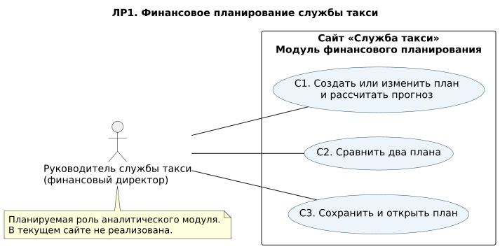

# ЛР1. Анализ финансового планирования службы такси

## 1. Назначение и основание
**Проект:** сайт АИС «Служба такси». **Раздел ЛР1:** планируемый модуль финансового планирования для руководителя службы.

Основание — PPO-Findirector-Labs.docx, требования П-Ф1–П-Ф6, правила П-Б1–П-Б10 и задание ЛР1-Д1–Д5, ЛР1-Т1. Финансовая модель сохраняется; студия сайтов заменена службой такси, типовая услуга — выполненная платная поездка.

**Цель:** дать руководителю возможность оценить прибыль и достаточность денег на три месяца, сравнить два варианта плана и повторно открыть сохранённые исходные данные. Главный вопрос: хватит ли денег на выполнение плана, если часть оплаты за поездки поступает только в следующем месяце?

**Статус:** спецификация будущего модуля. Расчёт, сравнение и хранение финансовых планов в текущем сайте не реализованы. В этой работе код приложения и рабочая БД не изменяются. Примеры ниже — ожидаемое поведение до реализации модуля, а не протокол его тестирования.

### 1.1. Связь с существующим сайтом
Текущий сайт обслуживает клиента, диспетчера и водителя: оценку стоимости маршрута, оформление, назначение и выполнение заказа. ЛР1 описывает отдельное аналитическое расширение для руководителя (финансового директора).

Плановые количества и средние цены вводятся вручную и не изменяют оформленные заказы, тарифы, статусы или доступность водителей. Средняя цена P в плане не заменяет тарифную формулу конкретной поездки. Планирование не объявляется уже существующей функцией. На следующих этапах потребуется спроектировать новый модуль и его доступ.

Технологический контекст сохраняется по П-О1: C#, .NET 10, Blazor Web App, SQLite, xUnit. В ЛР1 классы, таблицы БД и код не разрабатываются; они относятся к следующим работам.

### 1.2. Границы модели
- Одна компания — служба такси, одна валюта — рубли, горизонт — ровно три условных месяца с номерами 1, 2, 3.
- Служба рассматривается как перевозчик, учитывающий всю цену поездки как свою выручку, а не как агрегатор, учитывающий лишь комиссию.
- Одна типовая услуга — выполненная и проданная поездка. Q — число поездок; P — их плановая средняя цена. Изменения маршрутов, спроса и классов тарифов отдельно не моделируются.
- V — средние переменные затраты на поездку, например вознаграждение водителя и топливо. F — постоянные расходы: аренда, диспетчерская, административные оклады. Одни и те же расходы не включаются одновременно в V и F.
- Все поездки выполняются в указанном месяце. Все затраты признаются и оплачиваются тогда же.
- A% выручки текущего месяца оплачивается в нём же; оставшаяся сумма целиком поступает через месяц. Это условная модель оплаты, например для договорных клиентов, а не утверждение о реальной задержке всех оплат такси.
- До первого месяца дебиторская задолженность равна нулю. Денежный остаток и задолженность переносятся между месяцами.
- Отрицательный денежный остаток — расчётный дефицит, а не разрешённый банковский овердрафт. Автоматическое заимствование не выполняется; расчёт продолжается.
- Налоги, кредитование, склад, амортизация, покупка автомобилей, распределение платежей внутри месяца, платёжный шлюз и интеграция с банком вне обязательной модели.
- Неоплаченные продажи третьего месяца остаются задолженностью. Четвёртый месяц не добавляется.
- Сохраняются исходные данные, отчёт вычисляется заново. Публикация плана и изменение операционной базы заказов не предусмотрены.

### 1.3. Пользователь и словарь
**Руководитель службы такси (финансовый директор)** создаёт и редактирует планы, рассчитывает прогноз, сравнивает варианты, сохраняет и открывает их. Клиент, диспетчер и водитель не являются участниками финансовых сценариев ЛР1. Порядок аутентификации руководителя и выдачи доступа будет определён при проектировании; текущие клиентские и водительские учётные записи не наделяются этой ролью автоматически.

| Термин | Определение |
|---|---|
| Выручка | Стоимость выполненных поездок месяца: R = Q × P; не равна фактически поступившим деньгам |
| Переменные расходы | Q × V — затраты, зависящие от числа поездок |
| Маржинальный доход | Выручка за вычетом переменных расходов: R − Q × V |
| Общие расходы | Переменные и постоянные расходы: E = Q × V + F |
| Прибыль | Выручка за вычетом общих расходов: R − E; может быть отрицательной |
| Поступления | Деньги от текущих поездок плюс погашение задолженности предыдущего месяца |
| Дебиторская задолженность | Стоимость выполненных поездок, ещё не оплаченная клиентами |
| Конечные деньги | Расчётный денежный остаток на конец месяца; может быть отрицательным |
| Кассовый разрыв | Нехватка денег, выявленная отрицательным конечным остатком, в том числе при положительной прибыли |
| Дополнительное начальное финансирование | Сумма, которую нужно добавить к стартовым деньгам, чтобы ни один месячный остаток не был отрицательным |
| Актуальный прогноз | Результат расчёта, соответствующий текущей версии исходных данных плана |

### 1.4. Объекты и входные данные
**План:** постоянный непустой идентификатор planId (UUID), название name, начальные деньги initialCash и ровно три объекта months. Название после удаления краевых пробелов непустое. План не является реальным заказом такси.

**Параметры месяца:** номер monthNumber; число поездок Q; средняя цена P; переменные затраты на поездку V; постоянные расходы F; доля оплаты A. Параметры каждого месяца независимы и могут отличаться.

| Поле | Тип по смыслу | Ограничение |
|---|---|---|
| planId | UUID | Непустой, сохраняется при редактировании |
| name | Строка | После trim не пустая |
| initialCash | Денежная сумма decimal | ≥ 0, не более двух знаков после запятой |
| monthNumber | Целое | 1, 2, 3; каждое встречается ровно один раз |
| Q | Целое число поездок | ≥ 0 |
| P, V, F | Денежные суммы decimal | ≥ 0, не более двух знаков после запятой |
| A | Целый процент | От 0 до 100 включительно |

**Результат месяца:** номер, выручка, переменные расходы, маржинальный доход, общие расходы, прибыль, оплата текущих продаж S, поступления, конечные деньги C и задолженность D. При C < 0 показывается «Не хватает денег»; при C = 0 дефицита нет.

**Результат плана:** три месячные строки; итоговая прибыль; конечные деньги C3; задолженность D3; потребность в дополнительном начальном финансировании.

**Результат сравнения:** названия и идентификаторы двух планов с четырьмя итогами каждого рядом. Суммы не складываются между планами; автоматического выбора «лучшего» плана нет.

## 2. Функциональные требования

| Код исходного задания | Требование для службы такси |
|---|---|
| П-Ф1 | Создавать и редактировать финансовый план с названием, начальными деньгами и параметрами трёх месяцев по П-Б8 и П-Б10 |
| П-Ф2 | Рассчитывать по каждому месяцу выручку, маржинальный доход, расходы, прибыль, поступления, деньги и задолженность; выдавать итоги П-Б7 |
| П-Ф3 | Показывать рядом результаты двух выбранных планов: прибыль, конечные деньги, задолженность и дополнительное финансирование |
| П-Ф4 | Сохранять исходные данные, выдавать список, открывать план после перезапуска; сохранение того же planId обновляет его без дубликатов и без изменения другого плана |
| П-Ф5 | При недопустимом вводе указывать поле и причину; расчёт и сохранение отклоняются целиком, прежняя сохранённая версия не портится |
| П-Ф6 | Каждый расчёт начинается заново с исходных данных; после их изменения прежний прогноз и затронутое сравнение скрываются до пересчёта |

Число поездок, средняя цена и расходы являются прогнозными входами. Расчёт не меняет их, не исправляет автоматически и не создаёт реальные заказы.

## 3. Правила финансовой модели

| Код | Правило |
|---|---|
| П-Б1 | Выручка R = Q × P. Переменные расходы = Q × V. Маржинальный доход = R − Q × V |
| П-Б2 | Общие расходы E = Q × V + F. Прибыль = R − E; отрицательная прибыль допустима |
| П-Б3 | Оплата текущих продаж S = Round(R × A / 100, 2, AwayFromZero). Задолженность на конец месяца D = R − S |
| П-Б4 | Поступления = S + задолженность на начало месяца. Вся начальная задолженность погашается; перед месяцем 1 она равна 0 |
| П-Б5 | Конечные деньги C = деньги на начало + поступления − E. Следующему месяцу передаются C и D |
| П-Б6 | При C < 0 есть нехватка денег; расчёт продолжается до месяца 3. При C = 0 дефицита нет; кредит не добавляется автоматически |
| П-Б7 | Итоговая прибыль — сумма прибыли трёх месяцев. Финансирование = max(0, −min(C1,C2,C3)). C3 и D3 показываются отдельно |
| П-Б8 | initialCash, P, V, F ≥ 0, не более двух десятичных знаков. Q — целое ≥ 0. A — целое 0…100. P < V допустимо |
| П-Б9 | Денежные операции — decimal. Округляется S до копейки по AwayFromZero; D вычисляется как R − S, а не отдельным округлением |
| П-Б10 | Постоянный planId, непустое название; ровно три месяца, номера 1,2,3 уникальны в плане |

Месяцы обрабатываются по monthNumber, а не по случайному порядку элементов во входном списке. До расчёта проверяется весь план. Синтаксическая ошибка числа, превышение числового диапазона реализации или невозможность представить результат должны давать отказ с причиной, без частичного отчёта; конкретные технические пределы будут зафиксированы в ЛР2.

## 4. Сценарии

### С1. Создание или изменение плана и расчёт
- **Участник:** руководитель службы такси.
- **Ввод:** planId, название, initialCash и три набора Q/P/V/F/A.
- **Предусловие:** создан новый либо открыт существующий план. Новый получает постоянный planId; при редактировании идентификатор сохраняется.
- **Действие:** пользователь вводит или меняет данные и нажимает «Рассчитать». Проверяется весь план; затем месяцы 1–3 вычисляются последовательно с переносом C и D.
- **Результат:** месячная таблица по П-Ф2 и четыре итога по П-Б7; исходный план не изменён. Повторный расчёт без правок совпадает с предыдущим.
- **Изменение:** любая правка названия, начальных денег или месячных входов немедленно делает результат неактуальным. Старый прогноз и сравнение с этим планом скрываются; независимый результат другого плана сохраняет актуальность.
- **Отказ:** неверное поле/структура — поле и причина, расчёта нет. Неустранимое переполнение — сообщение, без частичного прогноза. Отрицательные расчётные C и прибыль не являются ошибками ввода.

### С2. Сравнение двух планов
- **Участник:** руководитель службы такси.
- **Ввод:** два различных planId, исходные планы и актуальные результаты С1.
- **Предусловие:** оба плана допустимы и рассчитаны после последнего изменения.
- **Действие:** выбрать два плана и нажать «Сравнить».
- **Результат:** рядом показаны названия и четыре итога каждого: прибыль, C3, D3, финансирование. Входы и результаты планов не изменяются. Повторное сравнение даёт те же значения.
- **Отказ:** не выбраны два плана, выбран один и тот же planId, план отсутствует или его расчёт неактуален — понятное сообщение, таблицы сравнения нет. Изменение одного участника скрывает сравнение до нового расчёта и команды сравнения.

### С3. Сохранение и открытие плана
- **Участник:** руководитель службы такси.
- **Ввод:** исходные данные плана для сохранения; planId из списка для открытия.
- **Действие:** «Сохранить» проверяет и атомарно сохраняет план с тремя месяцами; «Список» выдаёт planId и название; «Открыть» загружает выбранные входы.
- **Результат:** данные доступны после перезапуска. Тот же planId обновляет существующий план, не добавляет копию и не меняет другой план. Допустимый план можно сохранить без предварительного расчёта. После открытия прогноз и сравнение отсутствуют до пересчёта; новый расчёт воспроизводит исходные показатели.
- **Отказ:** ошибка ввода — поле и причина, записи нет; сбой хранилища — предыдущая версия остаётся целой; неизвестный planId — «План не найден»; повреждённые входы — отказ без частичной загрузки.
- **Несохранённые изменения:** перед открытием другого плана предложить «Сохранить», «Отбросить», «Отмена». Неуспешное сохранение не разрешает переключение; «Отмена» сохраняет текущий экран и введённые данные.

## 5. Восемь приёмочных примеров
Ожидания заданы до реализации финансового модуля. Это не результаты запуска сайта. Все суммы в рублях; контрольные планы независимы и не зависят от реального числа заказов сайта.

### 5.1. Общий контрольный набор
- План A: planId = `11111111-1111-4111-8111-111111111111`, name = «Такси — оплата через месяц».
- План B: planId = `22222222-2222-4222-8222-222222222222`, name = «Такси — половина сразу».
- Если не оговорено иначе: initialCash = 50 000.00; в каждом из месяцев 1,2,3 Q = 500, P = 300.00, V = 100.00, F = 70 000.00. A задаётся примером.
- R = 500×300 = 150 000; переменные расходы = 50 000; маржинальный доход = 100 000; E = 120 000; прибыль = 30 000 за месяц.
- В исходном контроле лектора 5 услуг × 30 000 и V = 10 000. Здесь выбраны 500 поездок × 300 и V = 100: месячные суммы, деньги и задолженность совпадают с исходным контролем.
- Каждый пример начинается заново. В ПР1–ПР6 используется A с нужными параметрами; сохранение и сравнение отдельно описаны в ПР7–ПР8.
- Колонки таблиц: «Оплата» — S только текущих поездок; «Поступления» включают погашение прошлого долга. C и D — остатки на конец месяца.

### ПР1. Оплата 0% в текущем месяце
**Ввод:** общий набор, план A, A1=A2=A3=0.
**Действие:** «Рассчитать», затем повторить без изменения входа.
**Ожидаемый результат:** обе попытки одинаковы; расчёт продолжается после отрицательного остатка, исходные данные не меняются.

| Месяц | Выручка | Марж. доход | Расходы | Прибыль | Оплата S | Поступления | Деньги C | Долг D |
|---|---:|---:|---:|---:|---:|---:|---:|---:|
| 1 | 150000 | 100000 | 120000 | 30000 | 0 | 0 | -70000 | 150000 |
| 2 | 150000 | 100000 | 120000 | 30000 | 0 | 150000 | -40000 | 150000 |
| 3 | 150000 | 100000 | 120000 | 30000 | 0 | 150000 | -10000 | 150000 |

Итоги: прибыль 90 000; C3 = −10 000; D3 = 150 000; финансирование 70 000. Оно равно максимальному дефициту, не сумме 70 000+40 000+10 000.
**Требования:** П-Ф1, П-Ф2, П-Ф6; П-Б1–П-Б7, П-Б9–П-Б10.

### ПР2. Оплата 50% в текущем месяце
**Ввод:** общий набор, план B, A1=A2=A3=50.
**Действие:** «Рассчитать».

| Месяц | Выручка | Марж. доход | Расходы | Прибыль | Оплата S | Поступления | Деньги C | Долг D |
|---|---:|---:|---:|---:|---:|---:|---:|---:|
| 1 | 150000 | 100000 | 120000 | 30000 | 75000 | 75000 | 5000 | 75000 |
| 2 | 150000 | 100000 | 120000 | 30000 | 75000 | 150000 | 35000 | 75000 |
| 3 | 150000 | 100000 | 120000 | 30000 | 75000 | 150000 | 65000 | 75000 |

Итоги: прибыль 90 000; C3 = 65 000; D3 = 75 000; финансирование 0. Долг третьего месяца к деньгам не прибавляется.
**Требования:** П-Ф1, П-Ф2; П-Б1–П-Б7, П-Б9–П-Б10.

### ПР3. Оплата 100% в текущем месяце
**Ввод:** общий набор, A1=A2=A3=100.
**Действие:** «Рассчитать».

| Месяц | Выручка | Марж. доход | Расходы | Прибыль | Оплата S | Поступления | Деньги C | Долг D |
|---|---:|---:|---:|---:|---:|---:|---:|---:|
| 1 | 150000 | 100000 | 120000 | 30000 | 150000 | 150000 | 80000 | 0 |
| 2 | 150000 | 100000 | 120000 | 30000 | 150000 | 150000 | 110000 | 0 |
| 3 | 150000 | 100000 | 120000 | 30000 | 150000 | 150000 | 140000 | 0 |

Итоги: прибыль 90 000; C3 = 140 000; D3 = 0; финансирование 0.
**Требования:** П-Ф1, П-Ф2; П-Б1–П-Б7, П-Б9–П-Б10.

### ПР4. Отсутствие продаж — поездок нет
**Ввод:** общий набор, Q1=Q2=Q3=0, A1=A2=A3=50. initialCash=50 000, F=70 000 в каждом месяце сохраняются.
**Действие:** «Рассчитать».

| Месяц | Выручка | Марж. доход | Расходы | Прибыль | Оплата S | Поступления | Деньги C | Долг D |
|---|---:|---:|---:|---:|---:|---:|---:|---:|
| 1 | 0 | 0 | 70000 | -70000 | 0 | 0 | -20000 | 0 |
| 2 | 0 | 0 | 70000 | -70000 | 0 | 0 | -90000 | 0 |
| 3 | 0 | 0 | 70000 | -70000 | 0 | 0 | -160000 | 0 |

План допустим. Итоги: прибыль −210 000; C3=−160 000; D3=0; финансирование 160 000. Постоянные расходы не исчезают при отсутствии поездок.
**Требования:** П-Ф2, П-Ф5; П-Б1–П-Б8, П-Б10.

### ПР5. Нулевые конечные деньги без дефицита
**Ввод:** общий набор с initialCash=75 000, F1=F2=F3=100 000, A1=A2=A3=50. Другие параметры прежние: Q=500, P=300, V=100.
**Действие:** «Рассчитать».

| Месяц | Выручка | Марж. доход | Расходы | Прибыль | Оплата S | Поступления | Деньги C | Долг D |
|---|---:|---:|---:|---:|---:|---:|---:|---:|
| 1 | 150000 | 100000 | 150000 | 0 | 75000 | 75000 | 0 | 75000 |
| 2 | 150000 | 100000 | 150000 | 0 | 75000 | 150000 | 0 | 75000 |
| 3 | 150000 | 100000 | 150000 | 0 | 75000 | 150000 | 0 | 75000 |

Во всех трёх месяцах C=0, включая итог C3=0; подпись «Не хватает денег» не выводится. Итоги: прибыль 0; C3=0; D3=75 000; финансирование 0. Проверка: C1=75 000+75 000−150 000=0; далее 0+150 000−150 000=0.
**Требования:** П-Ф2; П-Б4–П-Б7.

### ПР6. Недопустимый процент
**Ввод:** общий набор ПР2, но A месяца 2 = 101. Остальные поля валидны.
**Действие:** «Рассчитать», затем «Сохранить».
**Ожидаемый результат:** обе операции отклонены целиком. Поле «Месяц 2 / Доля оплаты A»; причина «Введите целый процент от 0 до 100». Новый прогноз и сравнение отсутствуют, новая запись не создаётся, прежняя сохранённая версия не изменяется. Частичный расчёт месяца 1 не показывается.
**Требования:** П-Ф5, П-Ф6; П-Б8.

### ПР7. Сравнение двух полных планов
**Ввод:** план A по ПР1 и план B по ПР2. Разные planId, оба результата актуальны.
**Действие:** выбрать A и B, нажать «Сравнить»; повторить.

| Показатель | План A: 0% сразу | План B: 50% сразу |
|---|---:|---:|
| Прибыль за 3 месяца | 90000 | 90000 |
| Конечные деньги C3 | -10000 | 65000 |
| Дебиторская задолженность D3 | 150000 | 75000 |
| Дополнительное финансирование | 70000 | 0 |

Ожидание: результаты рядом, повтор совпадает, исходные планы не меняются. При одинаковой прибыли более ранняя оплата увеличивает доступные деньги и уменьшает задолженность. Изменить initialCash у A на 120 000: старый прогноз A и сравнение немедленно скрываются; результат B остаётся актуальным. До пересчёта A сравнение отклоняется. После пересчёта A: C1=0, C2=30 000, C3=60 000; прибыль 90 000, D3=150 000, финансирование 0.
**Требования:** П-Ф3, П-Ф6; П-Б3–П-Б7.

### ПР8. Сохранение, открытие, изменение и пересчёт
**Ввод:** пустое хранилище; A по ПР1 и B по ПР2, идентификаторы из 5.1.
**Действия и ожидаемые результаты:**
1. Рассчитать и сохранить A и B. Список содержит ровно два planId, названия соответствуют входам.
2. Перезапустить приложение, создать новый экземпляр хранилища; открыть B. Все исходные поля, включая идентификаторы, номера месяцев и денежные значения, совпадают. Прогноза до расчёта нет. «Рассчитать» воспроизводит ПР2.
3. Рассчитать открытый A и сравнить с B: значения ПР7. Изменить у B только A месяца 1: 50→100. Старый прогноз B и сравнение скрываются; результат A не меняется. Сравнение до пересчёта B отклоняется.
4. Рассчитать B. Ожидания приведены ниже. Повторный расчёт не меняет результат и не прибавляет задолженность второй раз.
5. Сохранить B с тем же planId. Список по-прежнему содержит два плана. A не изменён.
6. Ещё раз перезапустить, открыть B и пересчитать: совпадают таблица и итоги ниже. A после открытия и пересчёта по-прежнему соответствует ПР1.

| Месяц | Выручка | Марж. доход | Расходы | Прибыль | Оплата S | Поступления | Деньги C | Долг D |
|---|---:|---:|---:|---:|---:|---:|---:|---:|
| 1 | 150000 | 100000 | 120000 | 30000 | 150000 | 150000 | 80000 | 0 |
| 2 | 150000 | 100000 | 120000 | 30000 | 75000 | 75000 | 35000 | 75000 |
| 3 | 150000 | 100000 | 120000 | 30000 | 75000 | 150000 | 65000 | 75000 |

Итоги изменённого B: прибыль 90 000; C3=65 000; D3=75 000; финансирование 0. Итоги совпали с прежним B, но C1 изменилось с 5 000 до 80 000: поэтому проверять нужно месячные строки и исходные данные, а не только итоги.
**Требования:** П-Ф1–П-Ф4, П-Ф6; П-Б3–П-Б5, П-Б7–П-Б10.

### 5.2. Ручная проверка ожиданий
Контрольный месяц: R=500×300=150 000; Q×V=50 000; маржинальный доход=100 000; E=120 000; прибыль=30 000.

При A=0: C1=50 000+0−120 000=−70 000; D1=150 000. C2=−70 000+150 000−120 000=−40 000. C3=−40 000+150 000−120 000=−10 000. Финансирование=max(0,70 000)=70 000.

При A=50: S=75 000, D=75 000. C1=50 000+75 000−120 000=5 000. C2=5 000+75 000+75 000−120 000=35 000. C3=35 000+75 000+75 000−120 000=65 000.

При A=100: S=150 000, D=0. Каждый месяц C увеличивается на 30 000: 80 000, 110 000, 140 000. Прибыль во всех трёх вариантах одинакова: 3×30 000=90 000.

Дополнительная граница округления для будущих тестов: во всех месяцах Q=1, P=0.01, V=F=0, A=50, initialCash=0. S=Round(0.005)=0.01, D=0; C=0.01/0.02/0.03; прибыль=0.03. Округление не теряет копейку и не создаёт отрицательный долг.

Контрольные ожидания также пересчитаны независимым скриптом decimal; результаты — docs/calculation-check.json. Это проверка чисел спецификации, а не тест приложения.

Дополнительные будущие проверки: A=-1 и 50.5; отрицательные initialCash/P/V/F; дробное Q; пустое название; неправильный набор месяцев; повтор номера; P<V; сбой записи; точное сохранение копеек; несовпадение актуальности прогноза; несуществующий ID. Они не заменяют восемь обязательных примеров.

## 6. Таблица соответствия

| Требование | Сценарии | Приёмочные примеры | Что подтверждается |
|---|---|---|---|
| П-Ф1 | С1 | ПР1–ПР3; ПР7; ПР8 шаги 3–4 | Создание плана и изменение отдельных входов |
| П-Ф2 | С1 | ПР1–ПР5; ПР8 | Месячные показатели и итоги трёх месяцев |
| П-Ф3 | С2 | ПР7; ПР8 шаг 3 | Сравнение двух независимых планов |
| П-Ф4 | С3 | ПР8 | Сохранение/список/открытие после перезапуска; обновление без дубликатов |
| П-Ф5 | С1, С3 | ПР6; ПР4 как допустимый нулевой объём | Поле и причина отказа; отсутствие расчёта и записи |
| П-Ф6 | С1, С2 | ПР1 повтор; ПР7 изменение; ПР8 шаги 3–6 | Пересчёт от входов и скрытие устаревших результатов |

| Пункт ЛР1 | Артефакт / раздел |
|---|---|
| ЛР1-Д1 | Раздел 1: цель, границы, полный финансовый словарь, план/месяц/результат |
| ЛР1-Д2 | Раздел 4: три сценария с вводом, действиями, результатом и отказом |
| ЛР1-Д3 | docs/diagrams/use-cases.puml и use-cases.svg: граница сайта, существующие действия клиента и С1–С3 руководителя (финансового директора) |
| ЛР1-Д4 | Раздел 5: восемь примеров, включая все запрошенные случаи |
| ЛР1-Т1 | Для каждого примера заданы входы, ожидания и ссылки П-Ф/П-Б; числа проверены до реализации модуля |
| ЛР1-Д5 | Раздел 6: связь всех П-Ф1–П-Ф6 со сценариями и примерами |

## 7. Диаграмма вариантов использования

Диаграмма показывает два уровня возможностей сайта. Клиент связан с существующими действиями: «Рассчитать стоимость поездки», «Создать заказ», «Просмотреть свои заказы». Руководитель (финансовый директор) связан с планируемым расширением: С1 «Создать или изменить план и рассчитать прогноз», С2 «Сравнить два плана», С3 «Сохранить и открыть план». Акторы расположены слева вне общей границы сайта, действия — внутри. Ассоциации обозначают доступные действия пользователя. Классы, формулы и база данных не изображаются как варианты использования.

Клиентские действия показаны для контекста и не входят в финансовые сценарии С1–С3. Диспетчер и водитель опущены на этой обзорной диаграмме; их функции общего сайта не меняются. Единственный участник именно финансового модуля — руководитель. Верхняя группа помечена «Существующие функции», нижняя — «Планируемое расширение».

## 8. Готовность комплекта и ограничения
Подготовлены спецификация и Use Case с исходником — артефакты ЛР1. Реализация модуля, схема хранения и классы не создавались. Ожидания не объявляются успешно пройденными тестами сайта. Сдача преподавателю и согласование аналитического расширения не подтверждены самим наличием файлов.

Отличие от ранее подготовленного PPO_TaxiWeb/docs/requirements.md: прежний документ описывает операционную систему заказов с расчётом цены маршрута. Настоящая ЛР1 — отдельная спецификация финансового расширения, более близкая к буквальным П-Ф/П-Б исходной методички. Она не заменяет прежнюю документацию сайта автоматически и не делает его соответствующим этой спецификации без дальнейшей реализации.

Для сдачи по П-О2 комплект нужно разместить в том же Git-репозитории, где находится проект, сохранив пути docs/requirements.md и docs/diagrams/use-cases.* в корне каталога этой лабораторной. Указывается реальный коммит сдачи. Метку lab1 создавать только при фактической сдаче; наличие ZIP не является меткой или приёмкой.
